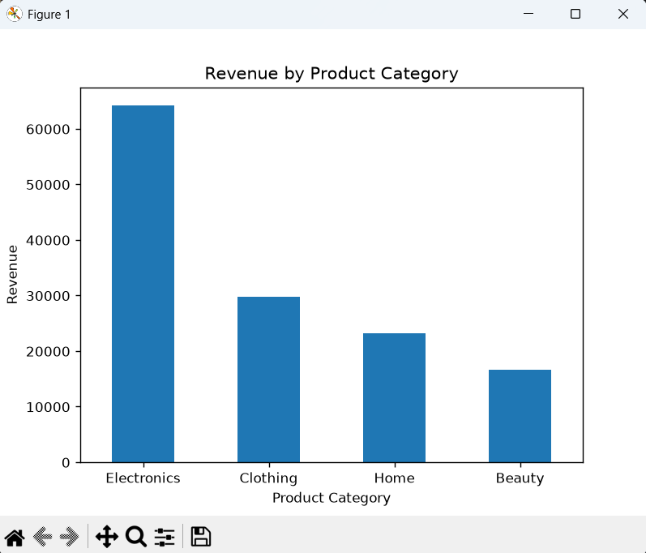
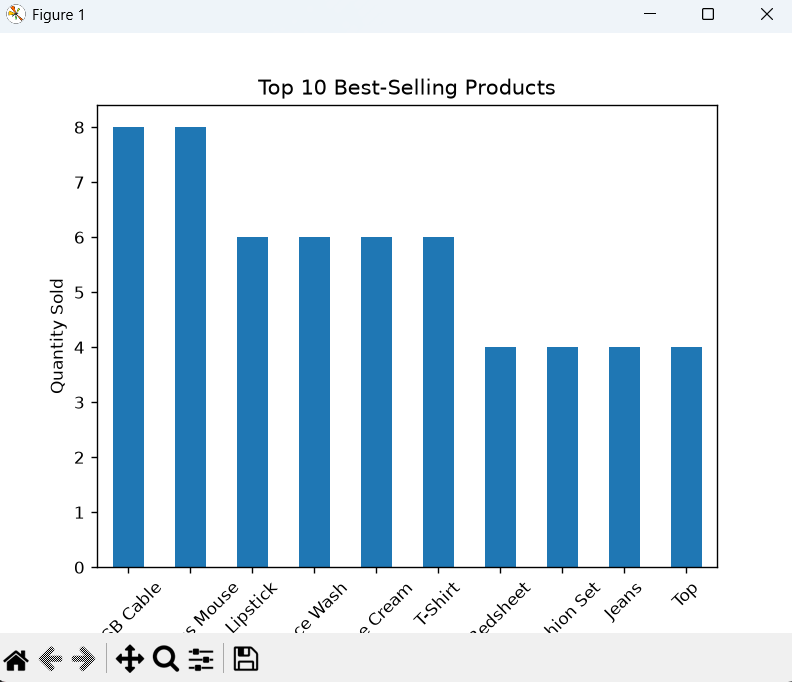
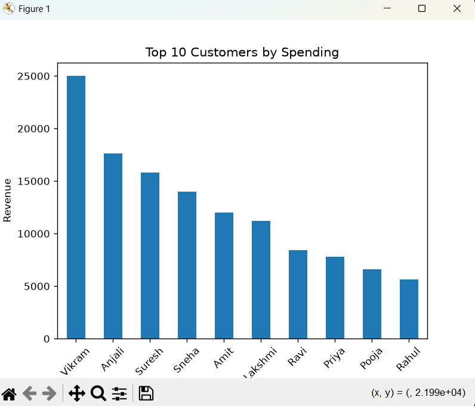
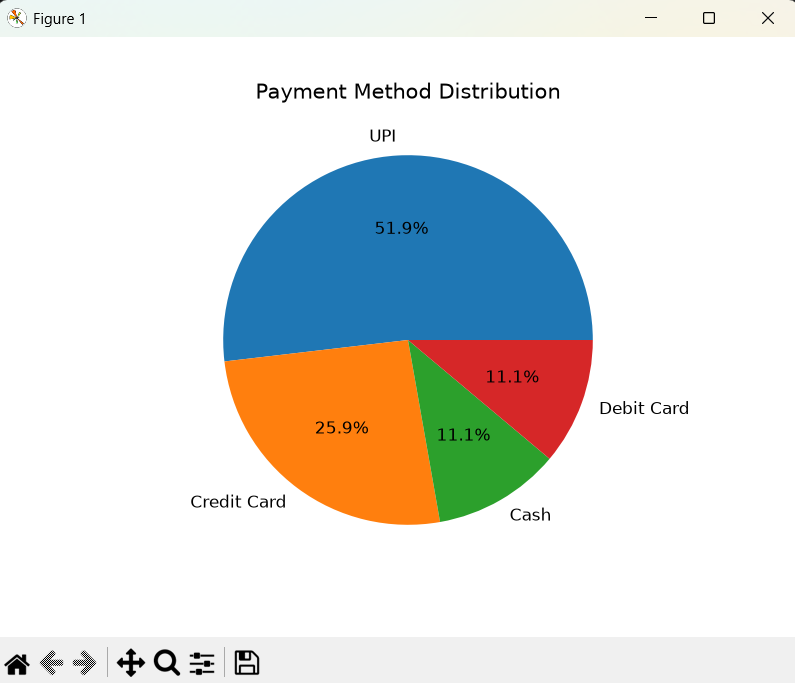

# E-Commerce Customer Behavior Analysis

## Project Overview

This project focuses on analyzing e-commerce customer purchasing behavior, revenue trends, product performance,
and payment preferences using Python, Pandas, SQL, and Matplotlib.

The objective is to extract meaningful insights from customer transaction data and understand overall business performance.

## Tools & Technologies
- Python
- Pandas
- SQL
- Matplotlib
- Exploratory Data Analysis (EDA)
- Data Visualization

## Project Structure

- `data/` – E-Commerce dataset
- `python/` – Python analysis code
- `sql/` – SQL queries
- `visualizations/` – Python visualization code
- `analysis_outputs/` – Visualization results and charts

---

## Data Visualization Results

### 1. Revenue by Product Category

**Insight:** Electronics generated the highest revenue (approximately 64K), followed by Clothing, Home, and Beauty.

### 2. Monthly Revenue Analysis

**Insight:** May recorded the highest monthly revenue, while January recorded the lowest.

### 3. Top 10 Best-Selling Products

**Insight:** This visualization identifies the top-performing products based on quantity sold.

### 4. Top 10 Customers by Spending

**Insight:** Vikram was the highest-spending customer, contributing approximately 25K in revenue.

### 5. Payment Method Distribution

**Insight:** UPI was the most preferred payment method, accounting for 51.9% of transactions, followed by Credit Card at 25.9%.

---

## Key Findings

- Electronics contributed the highest category revenue.
- May recorded the strongest monthly sales performance.
- UPI was the dominant payment method.
- High-value customers contributed significantly to overall revenue.
- Product-level analysis helped identify the best-selling items.

## Conclusion

This project demonstrates practical experience in data cleaning, SQL querying, exploratory data analysis, and Python data visualization to understand e-commerce business performance and customer behavior.
